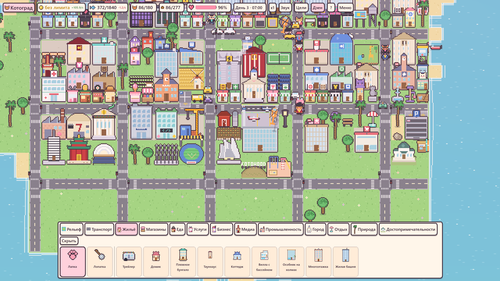

# 🐾 Котоград

Уютный пиксельный градостроитель о котиках на острове у берегов Лос-Анджелеса. Поставьте первый домик у воды и дождитесь новосёла. Когда-нибудь здесь появятся оживлённые улицы и чудеса света, а пока можно просто погладить первого жителя.

**[▶ Играть в браузере](https://vangogit.github.io/kotograd/)**

## 🌴 От домика у воды до целого города

Береговую линию рисуете вы. Насыпьте землю под новый квартал, оставьте бухту для рыбацкого причала или поселите котиков на холме с видом на океан. Проложите дорогу от причала до суши-бара и понаблюдайте, как грузовик повезёт туда свежий улов.

## 🐈 У каждого котика свои планы

Котики надевают форму и отправляются на работу, встречаются в кафе и заводят друзей. У каждого свой характер и свои желания. Присмотритесь к соседям по одной улице — пока один уже уехал на смену, другой ещё спит. А если среди городских дел найдётся минутка на ласку, в Котограде есть достижение «Главный по почесушкам».

## ✨ Когда остров обживётся

Можно устроить городской праздник, привлечь туристов или взяться за большую стройку и собрать все одиннадцать достопримечательностей. А можно заняться любимой улочкой — посадить пальмы, поставить скамейку у фонтана и посмотреть, кто пройдёт мимо.
