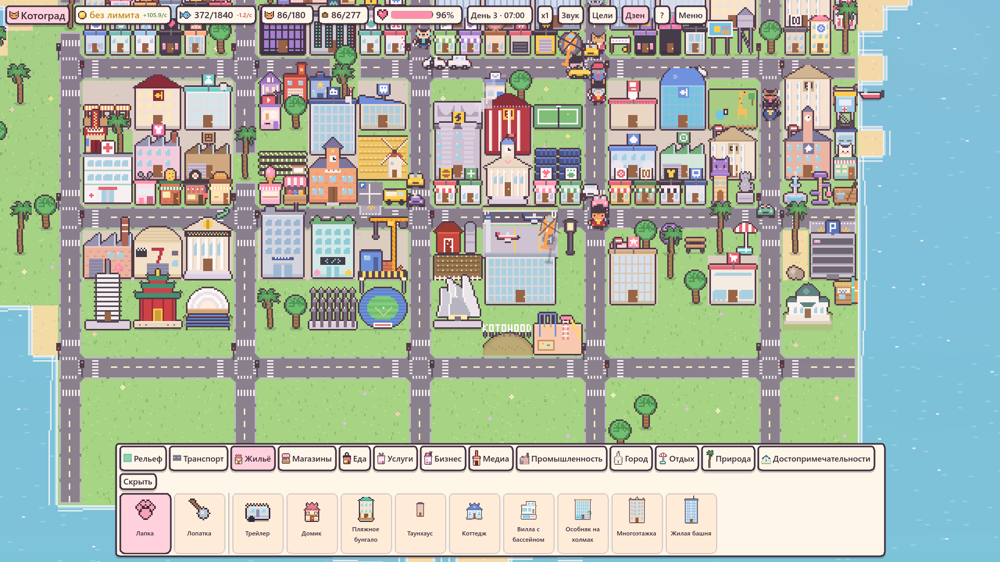

# Котоград

Уютный пиксельный градостроитель, где живут котики: строят дома, ходят на работу в форме и ездят на машинах.
Игра начинается на крошечном острове у побережья Лос-Анджелеса — сушу можно бесплатно насыпать и убирать, а в конце возводить чудеса света.

**▶ [Играть в браузере](https://vangogit.github.io/kotograd/)**



## Как запустить

1. Откройте Godot (4.7).
2. В менеджере проектов нажмите **Импорт** и выберите эту папку (файл `project.godot`).
3. Нажмите **▶ Запустить** (F5).

## Веб-версия

Игра собирается в браузерную версию самим Godot.

**Автоматически через GitHub.** После каждой отправки кода в ветку `main` GitHub сам собирает игру и выкладывает её на GitHub Pages.
Один раз включите: репозиторий → **Settings → Pages → Source: GitHub Actions**.
Адрес игры: `https://<ваш-логин>.github.io/<имя-репозитория>/`.

**Вручную.** В Godot: **Проект → Экспорт → Web → Экспорт проекта** в `build/web/index.html`.
Проверить локально: `python3 -m http.server 8123 -d build/web` и открыть http://localhost:8123.

В браузере сохранение хранится в памяти браузера; экспорт сохранения скачивает файл, импорт открывает выбор файла.

## Тесты

Тесты запускаются без окна (их же гоняет сборка на GitHub перед публикацией):

```bash
godot --headless --path . -s res://tests/save_test.gd   # сохранения: .bak, повреждённые и новые файлы
godot --headless --path . -s res://tests/tr_test.gd     # у каждой русской строки есть английский перевод
godot --headless --path . -s res://tests/sim_test.gd    # большой город живёт два игровых дня без ошибок
godot --headless --path . -s res://tests/ui_test.gd     # титульный экран, вкладки, карточки, окна
```

Замер кадра — в окне: `godot --path . -s res://tests/bench_draw.gd`.

## Устройство кода

`scripts/world.gd` (`KotoWorld`) — состояние города, главный цикл, машины, стройка, камера и ввод.
Остальное — модули с полем `world`:

| Модуль | Что делает |
| --- | --- |
| `saves.gd` | сохранение и загрузка, резервная копия, старые версии формата |
| `mapgen.gd` | генерация островов |
| `economy.gd` | монетки, еда, счастье, производство, грузовики |
| `cats.gd` | жизнь котиков: дом, работа, досуг, поездки |
| `paths.gd` | поиск путей пешком и по дорогам |
| `ground.gd` | земля и дороги в картинке, по кускам |
| `drawer.gd` | отрисовка построек, котиков, машин и эффектов |
| `transit.gd`, `boats.gd`, `events.gd`, `goals.gd` | поезда и самолёты, лодки, события, цели |
| `ui.gd`, `title.gd` | интерфейс и титульный экран |
| `sprites.gd`, `buildgen.gd`, `sound.gd` | пиксельная графика и звук, нарисованные кодом |
| `defs.gd`, `lang_en.gd` | данные построек и английский перевод |

## Лицензия

[MIT](LICENSE)
